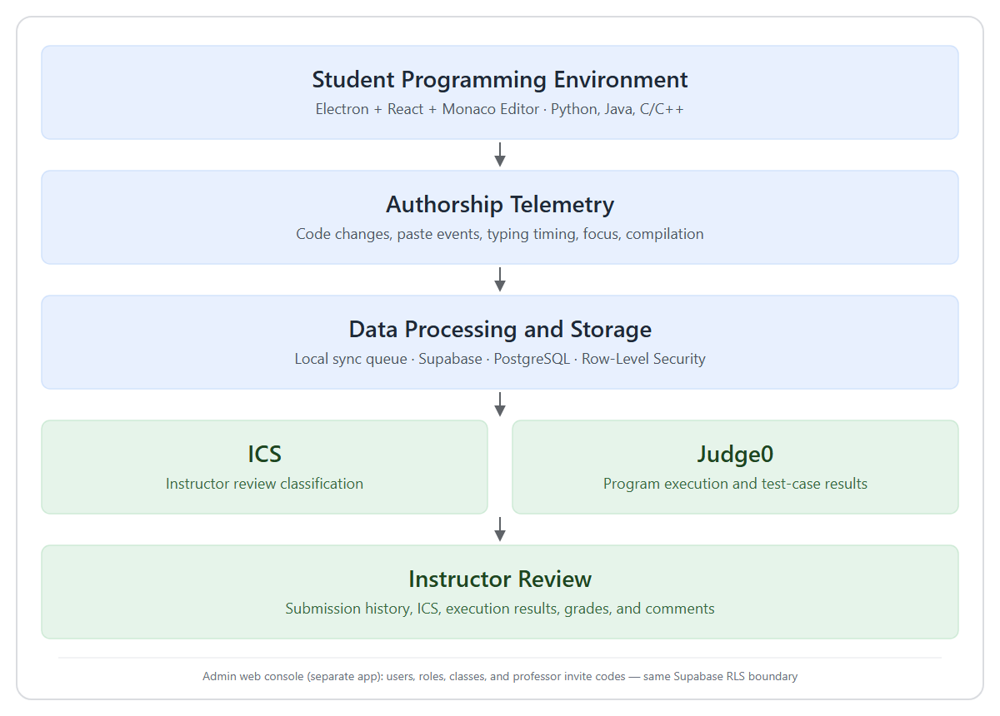
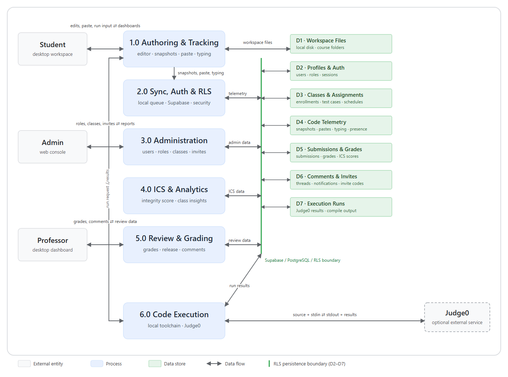
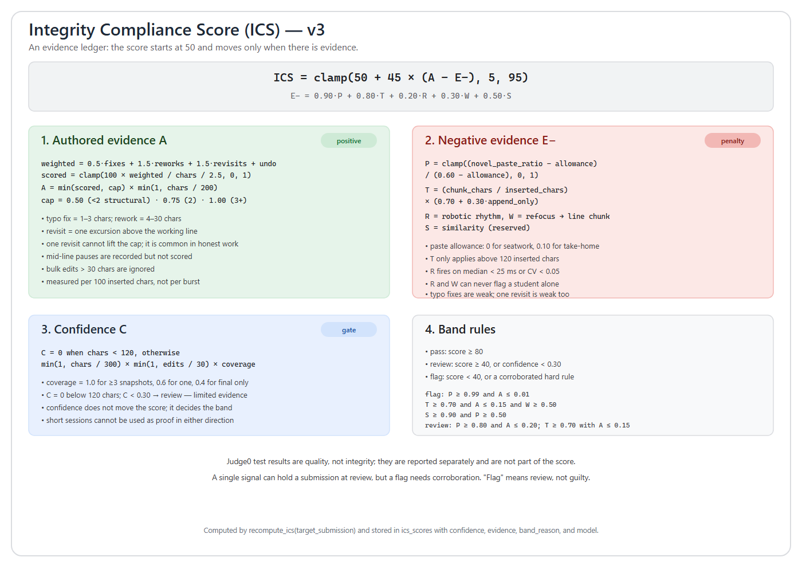

# Unicode Lab — Technical Overview

This document describes the current implementation in enough detail to support a
capstone paper, defense, or handover. It is organized by architecture, data
model, subsystem, security boundary, and data flow.

---

## 1. Purpose and scope

Unicode Lab is a desktop programming-course environment with three cooperating
surfaces:

| Surface       | Technology                      | Primary user          | Responsibility                                                  |
| ------------- | ------------------------------- | --------------------- | --------------------------------------------------------------- |
| Desktop app   | Electron + React + TypeScript   | Student and professor | Files, editor, tracking, submissions, review, grading, Live Lab |
| Admin console | React + Vite                    | Administrator         | Users, roles, classes, professor invite codes                   |
| Backend       | Supabase Postgres/Auth/Realtime | All clients           | Identity, persistence, RLS, RPCs, realtime fan-out              |

The application prioritizes:

- real files on disk rather than an in-browser sandbox;
- automatic, auditable edit history;
- paste and authorship evidence;
- professor review workflows that are useful without trusting a single score;
- RLS as the primary authorization mechanism;
- an offline-tolerant capture queue.

---

## 2. System context

```text
┌──────────────────────────────┐        ┌──────────────────────────────┐
│ Electron desktop app         │        │ Admin web console            │
│                              │        │                              │
│ Student workspace            │        │ Users / roles / classes      │
│ Professor dashboard          │        │ Professor invites            │
│ Live Lab / review / grading  │        │                              │
└──────────────┬───────────────┘        └──────────────┬───────────────┘
               │ Supabase JS (publishable key)         │
               ▼                                       ▼
┌───────────────────────────────────────────────────────────────────────┐
│ Supabase                                                              │
│ Postgres + Auth + RLS + Realtime + SECURITY DEFINER RPCs             │
└───────────────────────────────────────────────────────────────────────┘
               │
               │ main-process IPC only
               ▼
┌───────────────────────────────────────────────────────────────────────┐
│ Electron main process                                                  │
│ filesystem bridge │ terminal │ toolchain probe │ Judge0 client         │
└───────────────────────────────────────────────────────────────────────┘
```



### Level 1 data flow



D1 is the local workspace on disk. D2–D7 are the Supabase tables read and
written through the PostgreSQL row-level-security boundary. Judge0 is optional
and external; local terminal/Run File execution uses the installed toolchain
instead.

---

## 3. Technology stack

| Layer                    | Choice                                                                  |
| ------------------------ | ----------------------------------------------------------------------- |
| Desktop shell            | Electron 44                                                             |
| UI                       | React 19, TypeScript                                                    |
| Bundling/dev             | electron-vite, Vite 8                                                   |
| Editor                   | Monaco Editor (`@monaco-editor/react`)                                  |
| Language analysis        | `@lezer/python`, `@lezer/java`, `@lezer/cpp`                            |
| Python language server   | Bundled Pyright (`pyright-langserver`) bridged through main-process IPC |
| Python fallback checking | Pyright CLI, executed through Electron in Node mode                     |
| Local compiler checks    | `javac` (Java), `gcc`/`g++` (C/C++), run in the main process            |
| Icons                    | `lucide-react`                                                          |
| Backend                  | Supabase Postgres, Auth, Realtime                                       |
| Similarity               | Postgres `pg_trgm`, local token-sequence similarity                     |
| Local terminal           | PowerShell child process managed in main                                |
| Remote execution         | Judge0 HTTP API, optional                                               |
| Tests                    | Vitest, live RLS script                                                 |
| Packaging                | electron-builder / NSIS                                                 |
| Admin console            | Separate Vite/React project                                             |

---

## 4. Repository structure

```text
src/
  main/
    index.ts          Electron window, lifecycle, IPC handlers
    fs.ts             Workspace-scoped filesystem bridge
    terminal.ts       Inline PowerShell session
    toolchains.ts     Compiler/runtime detection and run planning
    diagnostics.ts    Local javac/gcc/g++ syntax + semantic diagnostics
    pythonLsp.ts      JSON-RPC bridge to the bundled Pyright language server
    bundledTools.ts   Resolves bundled tools in dev and asar-packaged builds
    judge0.ts         Judge0 HTTP client and token storage
  preload/
    index.ts          contextBridge APIs
    index.d.ts        window typings
  renderer/
    src/
      App.tsx         Session/role routing and workspace composition
      components/
        StudentDashboard.tsx
        AssignmentDetailModal.tsx
        JoinClassModal.tsx
        ProfessorInviteModal.tsx
        IntegrityDemo.tsx
        EditorPane.tsx
        WorkspacePanel.tsx
        BottomPanel.tsx
        TerminalPanel.tsx
        TestCasesPanel.tsx
        professor/
          ProfessorDashboard.tsx
          ClassGrid.tsx
          ClassOverview.tsx
          AssignmentModal.tsx
          AssignmentView.tsx
          SubmissionTable.tsx
          SubmissionDetail.tsx
          SnapshotTimeline.tsx
          IcsPanel.tsx
          TypingHeatmap.tsx
          PasteSimilarityPanel.tsx
          LiveLabView.tsx
          GradeBox.tsx
      hooks/
        useSupabaseSession.ts
        useProfileRole.ts
        useEnrolledCourses.ts
        useStudentAssignments.ts
        useStudentFeedback.ts
        usePendingSubmissions.ts
        useRealtimeRefresh.ts
        useCodeTracker.ts
        useStudentPresence.ts
        useToolchainStatus.ts
      lib/
        supabase.ts
        professorQueries.ts
        studentAssignments.ts
        enrollments.ts
        professorInvites.ts
        ics.ts
        analytics.ts
        similarity.ts
        gradebook.ts
        submissionQueue.ts
        snapshotQueue.ts
        notifications.ts
        judge0.ts
        runCommand.ts
        codeAnalysis.ts
        sourceAnalysis.ts
        pythonAnalysis.ts
        javaAnalysis.ts
        cppAnalysis.ts
  shared/             Main/preload/renderer shared types
supabase/
  migrations/         Database source of truth
  RLS_TEST_NOTES.md   Per-view access expectations
scripts/
  seed.mjs            Idempotent demo data
  rls-check.mjs       Live RLS regression suite
admin-web/            Separate admin console
docs/                 Paper and QA documentation
```

---

## 5. Identity, roles, and session routing

### 5.1 Authentication

- Supabase Auth handles email/password sign-in, sign-up, session persistence,
  recovery, and token refresh.
- The renderer uses only the publishable/anon key.
- Development defaults to **no email confirmation**; production builds default
  to **confirmation required**. `VITE_AUTH_EMAIL_CONFIRMATION` can override this.
- The Supabase project must match: disable **Confirm email** in the dev project
  and enable it in production. If production returns a sign-up session, the app
  signs out and reports the mismatch.
- `profiles.role` is one of `student`, `professor`, `admin`.
- A trigger on `auth.users` creates the matching `profiles` row.
- Desktop routing:
  - `student` → student dashboard/workspace
  - `professor` → professor dashboard
  - `admin` → admin console notice

### 5.2 Role protection

- Table-level `UPDATE` is revoked from `authenticated` on `profiles`, then only
  `email` and `display_name` are re-granted.
- A trigger blocks role changes unless an admin RPC or the invite redemption
  transaction flag is active.
- `admin_set_role` enforces:
  - caller is admin;
  - cannot change self;
  - known role;
  - last admin cannot be demoted;
  - professor with classes cannot be demoted without reassignment/deletion.

### 5.3 Professor invites

- Admin-only table `professor_invites`.
- Admin RPC creates `PROF-XXXX-XXXX` codes with:
  - lifespan in hours (1–8760);
  - maximum uses (1–1000);
  - optional note.
- The desktop **Create account** form has an optional **Professor invite code**
  field.
- When sign-up returns a session (development), the app redeems the code
  immediately, clears it from user metadata, and reloads the role.
- When confirmation is required (production), the code is stored in metadata and
  a one-time App effect redeems it after the confirmed user signs in.
- Redemption (`redeem_professor_invite`):
  - requires signed-in student;
  - locks the invite row;
  - checks revoked/expired/used-up;
  - increments uses and records last user/time;
  - sets `app.professor_invite` transaction-local GUC;
  - updates `profiles.role = 'professor'`;
  - the role guard accepts only this path.
- Admin can revoke a code; redemption then fails.

---

## 6. Data model

### 6.1 Core academic tables

| Table                 | Key fields                                                                                                                                                                                                                                                  | Purpose                                               |
| --------------------- | ----------------------------------------------------------------------------------------------------------------------------------------------------------------------------------------------------------------------------------------------------------- | ----------------------------------------------------- |
| `profiles`            | `id`, `email`, `display_name`, `role`, `created_at`                                                                                                                                                                                                         | User identity and role                                |
| `classes`             | `id`, `name`, `code`, `professor_id`, `join_code`, `year_section`, `academic_year`, `archived_at`                                                                                                                                                           | Course/class instance                                 |
| `enrollments`         | `class_id`, `student_id`, PK                                                                                                                                                                                                                                | Student-class membership                              |
| `assignments`         | `id`, `class_id`, `title`, `description`, `language`, `file_name`, `starter_code`, `published`, `publish_at`, `due_at`, `auto_test_enabled`, `archived_at`, `kind`, `timing_mode`, `duration_minutes`, `opens_at`, `closes_at`, `auto_submit`, `show_timer` | Assignment/seatwork definition and optional timing    |
| `assessment_sessions` | `id`, `assignment_id`, `student_id`, `status`, `started_at`, `expires_at`, `submitted_at`, `last_saved_at`, `draft_revision`, `final_submission_id`                                                                                                         | One server-owned timed attempt per student/assessment |
| `assessment_drafts`   | `session_id` PK, `content`, `revision`, `updated_at`                                                                                                                                                                                                        | Latest autosaved content for a timed attempt          |
| `test_cases`          | `id`, `assignment_id`, `stdin`, `expected_stdout`, `ordinal`, `is_hidden`                                                                                                                                                                                   | Judge0 test definitions                               |
| `submissions`         | `id`, `assignment_id`, `student_id`, `final_snapshot_id`, `status`, `submitted_at`, `grade`, `graded_at`, `graded_by`, `client_token`, `grade_released`, `grade_released_at`, `snapshots_pruned_at`, `snapshots_pruned_count`                               | Submission record                                     |
| `submission_grades`   | `submission_id` PK, `grade`, `graded_at`, `graded_by`                                                                                                                                                                                                       | Professor-only private mark                           |
| `code_snapshots`      | `id`, `user_id`, `submission_id`, `file_name`, `content`, `snapshot_type`, `version`, `char_count`, `line_count`, `language`, `typing_intervals`, `edit_stats`, `focus_stats`, `created_at`                                                                 | Edit history                                          |
| `paste_events`        | `id`, `snapshot_id`, `user_id`, `file_name`, `pasted_text`, `pasted_chars`, `paste_mode`, `detected_via`, `created_at`                                                                                                                                      | Paste audit trail                                     |
| `ics_scores`          | `submission_id` PK, term fields, `ics`, `band`, `computed_at`, `settings_version`, `settings_snapshot`                                                                                                                                                      | Integrity score                                       |
| `ics_settings`        | `id = 1`, version, base/floor/ceiling, authored and negative weights, band thresholds, pass minimum, confidence gate                                                                                                                                        | Admin-managed metric                                  |
| `comments`            | `id`, `submission_id`, `author_id`, `snapshot_id`, `parent_id`, `anchor_line`, `body`, `created_at`                                                                                                                                                         | Feedback threads                                      |
| `code_runs`           | submission/test/snapshot references, status, outputs, timing                                                                                                                                                                                                | Judge0 execution history                              |
| `professor_invites`   | `id`, `code`, `note`, `created_by`, `expires_at`, `max_uses`, `uses`, `revoked_at`, timestamps                                                                                                                                                              | Professor onboarding                                  |
| `student_presence`    | `student_id` PK, `current_file`, `status`, `idle_seconds`, `last_seen_at`, `updated_at`                                                                                                                                                                     | Live Lab heartbeat                                    |

### 6.2 Relationships

```text
profiles (professor) 1 ─── * classes 1 ─── * assignments 1 ─── * test_cases
     │                         │                    │
     │                         │                    └── * submissions 1 ─── 1 ics_scores
     │                         │                              │
     │                         └── * enrollments * ──────────┤
     │                                                        ├── * code_snapshots
     │                                                        ├── * paste_events
     │                                                        ├── * comments
     │                                                        └── 1 submission_grades

profiles (student) 1 ─── * submissions
                  1 ─── 1 student_presence
                  1 ─── * code_snapshots / paste_events / comments

profiles (admin) 1 ─── * professor_invites (created_by)
```

### 6.3 Public RPCs and helper functions

| Function                                         | Caller            | Purpose                                                               |
| ------------------------------------------------ | ----------------- | --------------------------------------------------------------------- |
| `submit_assignment`                              | Student           | Enrollment check, submission, snapshot attachment, idempotent token   |
| `join_class_by_code`                             | Student           | Join active class by code                                             |
| `rotate_class_join_code`                         | Professor         | Rotate class code                                                     |
| `add_student_to_class` / `add_students_to_class` | Professor         | Roster management                                                     |
| `recompute_ics` / `recompute_ics_for_assignment` | Professor         | Integrity score computation with the current admin metric             |
| `prune_submission_snapshots`                     | Professor/Service | Dry-run or apply evaluation-safe snapshot retention                   |
| `admin_fetch_ics_settings`                       | Admin             | Read the global ICS metric                                            |
| `admin_update_ics_settings`                      | Admin             | Validate, version, and save the ICS metric                            |
| `admin_reapply_ics_settings`                     | Admin             | Re-score stored v3 evidence with the current metric                   |
| `save_submission_grade`                          | Professor         | Save private mark and hide public copy                                |
| `set_submission_grade_release`                   | Professor         | Release/hide one grade                                                |
| `release_assignment_grades`                      | Professor         | Bulk release                                                          |
| `admin_set_role`                                 | Admin             | Guarded role change                                                   |
| `admin_create_professor_invite`                  | Admin             | Generate invite                                                       |
| `admin_revoke_professor_invite`                  | Admin             | Revoke invite                                                         |
| `redeem_professor_invite`                        | Student           | Promote via invite                                                    |
| `touch_student_presence`                         | Student           | Upsert own heartbeat                                                  |
| `professor_paste_matches`                        | Professor         | Class-scoped pg_trgm matches                                          |
| `start_assessment_session`                       | Student           | Start or resume the single attempt; returns server deadline and draft |
| `get_assessment_session`                         | Student/Professor | Read session state and server clock; no draft for professors          |
| `save_assessment_draft`                          | Student           | Autosave content with a monotonic revision                            |
| `submit_assessment_session`                      | Student           | Finalize within 10s grace or auto-submit the latest draft             |
| `expire_assessment_sessions`                     | Authenticated     | Lazily finalize every past-deadline active session                    |
| `fetch_assessment_sessions`                      | Professor         | Session monitor for one assessed assignment                           |
| `finalize_assessment_session`                    | Internal          | Create the submission/final snapshot and close the session            |

Helper functions used by RLS: `is_admin`, `is_professor_of_class`,
`is_professor_of_submission`, `is_professor_of_snapshot`,
`is_enrolled_in_class`, `class_of_assignment`, `owns_submission`.

### 6.4 Views

| View                  | Purpose                                                                      |
| --------------------- | ---------------------------------------------------------------------------- |
| `student_submissions` | Student-facing submission rows; masks unreleased grade and release timestamp |

---

## 7. Row-Level Security and authorization

RLS is the authority for row visibility. The app never relies on UI hiding alone.

### 7.1 Main policies

| Area              | Student                                        | Professor                               | Admin         |
| ----------------- | ---------------------------------------------- | --------------------------------------- | ------------- |
| Profiles          | Own row                                        | Own + enrolled students                 | All profiles  |
| Classes           | Enrolled, non-archived                         | Own classes                             | All classes   |
| Enrollments       | Own                                            | Own classes                             | All           |
| Assignments       | Published, non-archived, `publish_at <= now()` | Own classes, including drafts/scheduled | Metadata      |
| Test cases        | Visible only                                   | All in own classes                      | Metadata only |
| Submissions       | Own                                            | Own classes                             | None          |
| Private grades    | None                                           | Own classes                             | None          |
| Comments          | Own submission threads                         | Own classes                             | None          |
| Paste events      | Own                                            | Own class submissions                   | None          |
| Presence          | Own row                                        | Own students                            | None          |
| Professor invites | None                                           | None                                    | All           |
| Code runs         | Own                                            | Own class submissions                   | None          |

### 7.2 Grade privacy

Two-layer design:

1. `submission_grades` stores the private mark and is professor-only.
2. `submissions.grade` is NULL until release; release copies the private value.
3. `student_submissions` masks grade/release timestamp as defense in depth.
4. Realtime therefore cannot leak a private mark through `submissions`.

### 7.3 Hidden tests and scheduled assignments

- Students only see `test_cases.is_hidden = false`.
- Student assignment RLS requires:
  `published AND archived_at IS NULL AND (publish_at IS NULL OR publish_at <= now())`.

### 7.4 Invite and presence guards

- Invite creation/revocation: admin only.
- Invite redemption: student only, row-locked, expiry/use checked.
- Presence heartbeat: writes only `auth.uid()`.
- Presence reads: own row or professor of an enrolled student.
- Paste similarity: professor of the target submission's class only.

### 7.5 Renderer hardening

- Chromium sandbox enabled.
- Preload exposes narrow typed wrappers only.
- Clipboard and external links go through main-process IPC.
- CSP blocks remote script execution.
- Service-role key never enters the renderer or bundle.
- Judge0 token stays in the main process / userData folder.

---

## 8. Desktop process architecture

### 8.1 Main process

Responsibilities:

- create the Electron window;
- load the renderer;
- register filesystem IPC;
- manage terminal sessions;
- detect toolchains;
- run local commands;
- call Judge0;
- handle native dialogs and external links.

### 8.2 Preload

The preload bridge exposes typed, narrow APIs such as:

- workspace root/read/write/list/create/rename/delete;
- native open/save dialogs;
- clipboard write;
- external link opening;
- terminal start/write/resize/clear;
- toolchain detection/recheck;
- Judge0 configuration/test calls;
- native confirm dialog.

The renderer cannot use Node or `ipcRenderer` directly.

### 8.3 Renderer

`App.tsx` owns:

- session state;
- role routing;
- open files/tabs;
- workspace state;
- active file and dirty state;
- assignment targeting;
- student view state (`dashboard` / `workspace`);
- student feedback modal;
- toast/error surfaces;
- presence heartbeat.

Major UI regions:

- title bar / menu bar;
- files sidebar;
- editor pane;
- bottom panel (terminal/live HTML preview/test cases);
- status bar;
- student dashboard overlay;
- professor dashboard;
- admin console notice.

---

## 9. Workspace and filesystem

- Workspace root is fixed at `Documents/Unicode Lab`.
- Class folders are derived from enrollments; project subfolders are user-created.
- The tree recursively lists text/code files and image assets (PNG, JPG, GIF, WebP, SVG, etc.).
- New File and New Folder target the selected class or project folder.
- Add Images opens a native multi-select picker and copies assets into that folder with collision-safe names.
- Filesystem operations are restricted to the workspace root in `src/main/fs.ts`.
- Assignment file names may include a project path such as `profile-project/index.html`.
- Native dialogs are the only way to open files outside the workspace.
- Tabs track dirty state against the last disk write.
- Closing a dirty tab prompts Save / Don’t Save / Cancel.
- Rename updates the open tab and disk file; images rename in the tree.
- Delete asks for native confirmation and closes the tab.
- External file changes appear after Refresh Workspace.
- Image assets open in the system viewer rather than Monaco.

---

## 10. Editor and language intelligence

### 10.1 Monaco

- Multi-file tabs.
- Syntax highlighting for supported languages.
- Themes and Monaco theme definitions.
- Font family/size/ligatures.
- Find/replace, command palette, quick open.
- Read-only snapshot viewer and DiffEditor.

### 10.2 Local language analysis

- Monaco's bundled Monarch definitions provide highlighting for Python, Java,
  C/C++, and the other supported file types. Java and C/C++ highlighting is the
  same grammar family VS Code uses for built-in language support.
- Lezer grammars (`@lezer/python`, `@lezer/java`, `@lezer/cpp`) produce syntax
  diagnostics for Python, Java, C, and C++.
- The status bar shows the diagnostic count for the active analyzed language.
- The outline extracts functions, methods, classes, namespaces, fields, and
  module-level names; clicking an entry jumps to its definition.
- Python has a conservative parser-level undefined-name pass covering params,
  imports, assignments, loops, `with`/`except` targets, comprehensions,
  lambdas, class methods, `self`, and builtins. A star import suppresses it.
- Python runs the bundled **Pyright language server** in the main process and
  bridges JSON-RPC over IPC to a small renderer-side LSP client. The client
  synchronizes open Python models and supplies type-aware completion, hover,
  and go-to-definition. Diagnostics continue to come from the Pyright CLI
  pipeline so there is only one marker owner and a predictable debounce.
- If the language server cannot start, the renderer falls back to the Lezer
  completion/hover providers and the Pyright CLI checker (also bundled). That
  path still provides full type diagnostics but not type-aware editor help.
- For Java and C/C++, the renderer debounces a request to the main process,
  which writes a temporary file and runs `javac` or `gcc`/`g++ -fsyntax-only`.
  Compiler diagnostics replace the parser diagnostics for the same model
  version. A missing toolchain leaves parser-only diagnostics and the status bar
  labels them as syntax checks.
- JavaScript/TypeScript diagnostics are provided by Monaco's bundled TypeScript
  worker; no extra process is involved.

Python get type checking without a language server; Java/C++ get compile-level
checking. Code actions, refactors, semantic tokens, and clangd-style
inspections remain out of scope.

---

## 11. Tracking engine

`useCodeTracker` is the core client-side telemetry pipeline.

### 11.1 Snapshot capture

- Content changes start a debounce timer (1.5 s).
- Automatic snapshots are at least 10 s apart.
- A waited burst is captured when the debounce fires.
- Submission capture forces a snapshot so the final file state is always stored.
- The tracker retains manual/restore APIs, but the student-facing time-travel
  browser is intentionally removed.
- Each snapshot stores content, type, version, character/line counts, language,
  typing intervals, and the authorship counters in `edit_stats`.

### 11.2 Paste detection

Two paths:

1. **Monaco paste event** — captures clipboard text and exact range.
2. **Velocity heuristic** — a burst of at least 120 inserted characters without
   a paste event is treated as suspected paste (drag/drop, middle-click, IME).

Paste events store the full pasted text for later similarity analysis.

### 11.3 Typing intervals

- One interval is recorded per content-change event when text is inserted.
- Undo/redo, restore, and paste events are excluded.
- Intervals are clamped to 20 ms–10 s, capped at 800 per snapshot.
- Intervals attach to the next snapshot and are cleared afterwards.
- This powers the professor typing-rhythm heatmap.

### 11.4 Queue and sync

- Captures are queued locally before Supabase writes.
- Snapshots are inserted before paste rows so `snapshot_id` references exist.
- Batch size: 25.
- Failed sync retries after 30 s; online/offline events trigger flush.
- Queue state is exposed in the status bar.
- Submissions use an idempotent `client_token` so retries cannot duplicate.

---

## 12. Student submission flow

```text
Student clicks Submit
        │
        ▼
Confirm dialog
        │
        ▼
Tracker flush/capture final snapshot
        │
        ▼
submit_assignment RPC
        │
        ├─ verify signed-in student
        ├─ verify enrollment
        ├─ create submission (client_token idempotency)
        ├─ attach unsent snapshots for the file
        ├─ create fallback snapshot if none exists
        └─ set final_snapshot_id
        │
        ▼
Dashboard refresh / toast
```

If the network is unavailable, the submission is queued locally and retried with
the same token when possible.

### 12.1 Timed assessments and live seatworks (Phase 1)

```text
Student clicks Start/Resume
        │
        ▼
start_assessment_session RPC
        ├─ verify enrollment, publication, opening/closing window
        ├─ return existing active session, or create one
        ├─ deadline = min(start + duration, closes_at)          (duration)
        ├─ deadline = min(opens_at + duration, closes_at)      (live_window)
        └─ return draft content + server_now
        │
        ▼
Workspace opens the draft in the assignment file
        │
        ├─ every 8s / window hide → save_assessment_draft
        ├─ countdown uses server_now offset, never the local deadline
        └─ deadline / Submit → submit_assessment_session
                                  ├─ within 10s grace: submitted
                                  ├─ after grace: latest draft, auto_submitted
                                  └─ finalize_assessment_session
                                       ├─ submissions row + assessment_session_id
                                       ├─ final code_snapshot
                                       └─ existing grade/ICS/comment pipeline
```

`pg_cron` is not installed, so `expire_assessment_sessions()` is called lazily by
the assessment RPCs and by the professor monitor. A student who closes the app
past the deadline is finalized the next time a session RPC or monitor refresh
runs. Phase 1 intentionally excludes tab-out detection, override codes, paste
blocking, fullscreen enforcement, MCQ quizzes, and exam-mode ICS changes.

---

## 13. ICS — Integrity Confidence Score (v3 evidence ledger)

The score is not a sum of positive-looking terms. It starts at 50 and moves only
when there is evidence. Confidence gates the band instead of moving the score.
The full rationale and edge-case matrix are in
[08_ICS_EVIDENCE_MODEL.md](08_ICS_EVIDENCE_MODEL.md).

### 13.1 Inputs

- Novel paste events and character counts (paste text that did not already
  exist in an earlier snapshot of the same submission).
- Snapshot authorship counters (`code_snapshots.edit_stats`): corrections,
  revisits, mid-line hesitation, line chunks, and immediate chunks after a
  window refocus.
- Window focus counters (`code_snapshots.focus_stats`): blurs, returns, away
  time.
- Typing intervals, used only for the automation check.
- Latest Judge0 pass/fail result per test case (shown as quality, not counted
  in integrity).
- Optional cross-submission similarity (`S`; the similarity panel remains a
  separate module for now).

### 13.2 Server computation

```text
A = min(clamp(100 × (0.5·typo_fixes + 1.5·reworks + 1.5·revisits + 1.0·undo)
          / inserted_chars / 2.5, 0, 1), cap)
    × min(1, inserted_chars / 200)
    typo fixes are capped at 5 × 0.5 weighted points
    cap = 0.50 with fewer than two structural events (rework, revisit, undo)
          0.75 with two
          1.00 with three or more
    one revisit is one excursion above the working line, not one per keystroke

P = clamp((novel_paste_ratio − allowance) / (0.60 − allowance), 0, 1)
    allowance = 0 for seatwork, 0.10 for take-home

T = (chunk_chars / inserted_chars)
  × (0.70 + 0.30 × clamp(1 − (reworks + undo) / (0.05·inserted_chars + 1), 0, 1))
    only when inserted_chars ≥ 120

R = 1 when ≥ 100 intervals and (median < 25 ms or coefficient of variation < 0.05)
W = (immediate_chunks / max(1, returns)) × min(1, returns / 3)
S = clamp((similarity − 0.75) / 0.25, 0, 1)      (reserved)

E− = clamp(0.90·P + 0.80·T + 0.20·R + 0.30·W + 0.50·S, 0, 1)
score = clamp(50 + 45 × (A − E−), 5, 95)

confidence = 0 when inserted_chars < 120, otherwise
             min(1, inserted_chars / 300)
           × min(1, (inserts + fixes + reworks) / 30)
           × coverage            (1 if ≥3 snapshots, 0.6 for one, 0.4 for final only)
```

Band:

```text
flag   if P ≥ 0.99 and A ≤ 0.01
flag   if T ≥ 0.7, A ≤ 0.15, and W ≥ 0.5
flag   if S ≥ 0.9 and P ≥ 0.5
review if P ≥ 0.8 and A ≤ 0.2
review if T ≥ 0.7, A ≤ 0.15, and inserted_chars ≥ 120
review if confidence < 0.30        (limited evidence never passes)
review if score ≥ 80 and inserted_chars < 300   (short submission never passes)
pass   if score ≥ 80
review if score ≥ 40
flag   otherwise
```

Line chunk = pause ≥ 1500 ms, then ≥ 20 chars from the line's first
non-whitespace column through the end of the line, with no correction in the
burst. Bulk edits > 30 chars (paste, select-all delete) are ignored.

Pauses are never scored on their own. A long pause is neutral; the evidence is
what happens when typing resumes.

Stored in `ics_scores` with `confidence`, `evidence` (jsonb), `band_reason`, and
`model` (`v3`, or `v2` for the legacy fallback). The four legacy term columns
are still populated as projections for analytics: paste, authorship in
`cadence_term`, away in `focus_term`, and Judge0 quality. They do not sum to
`ics` in v3.

The formula values shown above are the shipped defaults. `ics_settings` holds
the live base score, authored/negative weights, score range, band thresholds,
pass minimum, and confidence gate. Each v3 row records `settings_version` and
`settings_snapshot`. An admin can re-apply the metric to stored v3 evidence via
`admin_reapply_ics_settings`; this reads only the evidence ledger, so it remains
available after snapshot retention. Legacy v2 rows keep their original formula.



### 13.3 Presentation

- ICS panel shows the score, band, confidence, evidence ledger, band reason, and
  model (`v3` or legacy `v2`).
- The typing-rhythm heatmap is available as a diagnostic view; intervals are not
  scored directly.
- Student-facing ICS demo uses the shipped default v3 evidence rules; the live
  database metric may be admin-adjusted. The workflow is: name a scenario →
  **Start recording** → type/paste → **Stop & save**. While
  recording, the demo samples score, band, confidence, evidence, and counts twice
  a second and plots the score timeline. The saved run includes that timeline and
  a compact keylog (change events plus raw keydown/keyup, cursor/selection,
  focus/blur, copy/cut/paste).
- **Copy JSON** exports saved runs; **Copy keylog** exports the current session’s
  event stream. Nothing is sent to the server.
- Judge0 results appear as a quality figure and are not counted in the
  integrity score.

---

## 14. Professor review views

### 14.1 Snapshot timeline

- Horizontally scrollable rail with nodes colored by snapshot type.
- Each node has a 36 px click target; the selected node scrolls into view.
- Hover/`title` shows timestamp, character delta, and paste info.
- Comments with line anchors can jump to the relevant snapshot/line.

### 14.2 Diff mode

- Uses Monaco `DiffEditor`.
- Original = previous snapshot, modified = selected snapshot.
- Inline mode (`renderSideBySide: false`) shows additions/deletions in one pane.
- Disabled for the first snapshot.
- Diff models are retained to avoid model-disposal warnings during mode changes.

### 14.3 Typing-rhythm heatmap

- Points are reconstructed by walking each snapshot’s `typing_intervals`
  backwards from the snapshot timestamp.
- Y-axis is log-scaled gap between edits.
- Median line and longest-pause statistic.
- Points above 2× median are visually emphasized as pauses.

### 14.4 Paste similarity

- `pg_trgm` compares the target submission’s pastes with other students in the
  same class.
- Minimum default similarity: 45%.
- Only pastes with at least 20 characters participate.
- Returns the best match per target paste with matched student and timestamp.
- RPC verifies the caller is the class professor.

### 14.5 Token similarity

- Separate from paste similarity.
- Compares final snapshot token sequences across students.
- Configurable threshold (60/75/90%).
- Normalizes identifiers; highlights review candidates, not verdicts.

### 14.6 Grading

- Save writes to `submission_grades` and clears public grade.
- Release copies to `submissions.grade` and sets `grade_released_at`.
- Hide removes the public copy.
- Bulk release operates on all saved unreleased grades in an assignment.

### 14.7 Live Lab

- Student heartbeat every 30 seconds through `touch_student_presence`.
- Client status:
  - `flagged` if a paste was recorded in the last 15 minutes;
  - `idle` if the workspace is not active or no input for 2 minutes;
  - `active` otherwise.
- Professor view marks a row offline after 90 seconds without a heartbeat.
- Realtime subscription refreshes the page; a manual Refresh button also exists.

---

## 15. Admin console

### 15.1 Separation

- `admin-web/` is a separate Vite/React project.
- It is deployed as a static site and is not part of the Electron bundle.
- It uses the same Supabase URL/publishable key as the desktop app.

### 15.2 Admin-only gate

- Sign-in uses Supabase Auth.
- Profile role must be `admin`; students/professors see “Not authorized”.
- Admin data policies expose profiles, classes, enrollments, assignment metadata,
  professor invites, and the single `ics_settings` row.
- Admin policies do not expose submissions, snapshots, paste events, or code.
- Re-applying the ICS metric reads only the stored v3 evidence ledger.

### 15.3 Operations

- Search/filter users.
- Change roles through `admin_set_role`.
- Review classes, professors, join codes, counts.
- Create professor invites with note, lifespan, and max uses.
- Adjust the global ICS metric, preview its effect, and re-apply it to stored v3
  evidence.
- Copy/revoke invites.
- See active/total invite counts.

---

## 16. Realtime and offline behavior

### 16.1 Realtime

- Supabase Realtime publication includes `submissions`, `comments`,
  `assignments`, and `student_presence`.
- Subscriptions are RLS-filtered by Supabase.
- Dashboards debounce refreshes by ~500 ms.
- Live Lab uses the same mechanism with a dedicated table.

### 16.2 Offline

- Snapshot and paste captures queue in localStorage-backed queues.
- Submissions queue with idempotent client tokens.
- Status bar shows queue/sync state.
- Retry triggers on online event, app focus, and 30 s timer.
- Queued items retry on the next launch if the app was closed.

---

## 17. Build, test, and release

| Concern           | Implementation                                  |
| ----------------- | ----------------------------------------------- |
| Dev               | `npm run dev` runs desktop + admin concurrently |
| Desktop only      | `npm run dev:desktop`                           |
| Admin only        | `npm run dev:admin`                             |
| Typecheck         | `npm run typecheck`                             |
| Lint              | `npm run lint`                                  |
| Unit tests        | `npm test` (Vitest, 121 tests)                  |
| RLS regression    | `npm run test:rls` (41 checks)                  |
| Production build  | `npm run build`                                 |
| Windows installer | `npm run build:win`                             |
| Admin build       | `npm --prefix admin-web run build`              |
| CI                | lint, typecheck, unit tests, production build   |
| Installer         | NSIS, per-user, unsigned                        |
| Checksum          | `dist/SHA256SUMS.txt`                           |

### Current release artifact

- `dist/unicode-desktop-1.0.0-setup.exe`
- SHA-256:
  `36BDD335629533BFC2DE73C93D87EC32F69519B006FF84B36CFAA9BA735F1BA4`

---

## 18. Seed data and demo state

`scripts/seed.mjs` is idempotent and creates deterministic demo data.

| Item        | Value                                                                                           |
| ----------- | ----------------------------------------------------------------------------------------------- |
| Professors  | `professor@unicode.test`, `professor2@unicode.test`, `professor3@unicode.test` / `Password123!` |
| Admin       | `admin@unicode.test` / `Password123!`                                                           |
| Students    | `student1@unicode.test` … `student10@unicode.test` / `Password123!`                             |
| CS101       | 6 students, 3 Python assignments                                                                |
| CS102       | 3 students, 2 Python assignments (one scheduled +3 days)                                        |
| CS201       | 4 students, Java assignment + Java test cases                                                   |
| CS301       | 3 students, C++ assignment + C++ test cases                                                     |
| HTML101     | 6 students, 5 HTML lessons, and a profile-page project; live local preview                      |
| Join codes  | `CS101J4K`, `CS102P8Q`, `CS201R7A`, `CS301M2Z`, `HTML101L5V`                                    |
| Grade state | student1 released 92; student2 private 78; student3 ungraded                                    |
| ICS v3 demo | student1 pass 95.0; student2 review 79.6; student3 flag 5.0 (live `recompute_ics`)              |
| Paste demo  | student3 has two pastes; student2 shares a 100% match                                           |
| Typing demo | seeded intervals produce jagged/steady/fast-flat rhythms                                        |

---

## 19. Key design decisions and trade-offs

| Decision                                          | Reason                                                           | Trade-off                                                              |
| ------------------------------------------------- | ---------------------------------------------------------------- | ---------------------------------------------------------------------- |
| Electron desktop app instead of VS Code extension | Real files, native dialogs, class workspace, full review surface | Larger binary, Windows-centric packaging                               |
| Fixed workspace                                   | Predictable file paths for assignments and tracking              | No user-chosen root                                                    |
| Supabase + RLS                                    | Fast multi-user backend with declarative authorization           | Requires network for shared features; RLS must be maintained carefully |
| Private grade table                               | Prevent API/Realtime leakage                                     | Extra table and copy step on release                                   |
| Masked student view                               | Defense in depth for grade visibility                            | Student feedback queries need a second lookup                          |
| Edit intervals, not raw keystrokes                | Privacy and storage efficiency                                   | Heatmap is a rhythm approximation; Authorship uses edit counters       |
| Per-device seen state                             | No extra notification tables                                     | No cross-device synchronization                                        |
| Token + pg_trgm similarity                        | Two complementary review signals                                 | Neither proves plagiarism                                              |
| Separate admin web app                            | Keeps admin surface out of student/professor bundle              | Second deployment target                                               |
| Unsigned installer                                | No certificate available                                         | SmartScreen warning                                                    |

---

## 20. Known technical limitations

- Judge0 execution depends on a reachable endpoint; the demo environment may not
  have one.
- ICS formula accuracy is under review/paused; the score is a review aid.
- Typing heatmap uses edit intervals, not raw key events.
- Live Lab depends on 30-second heartbeats; offline detection is client-side.
- Notification seen state is per device.
- Similarity panels are heuristics, not plagiarism verdicts.
- PowerShell terminal is pipe-based, not a full PTY.
- Toolchain detection only checks PATH presence, not version.
- macOS/Linux packaging scripts exist but were not validated.
- No code signing, auto-update, SSO, audit-log export, or production legal pack.
- Professor invites are shared out-of-band and are not rate-limited.
