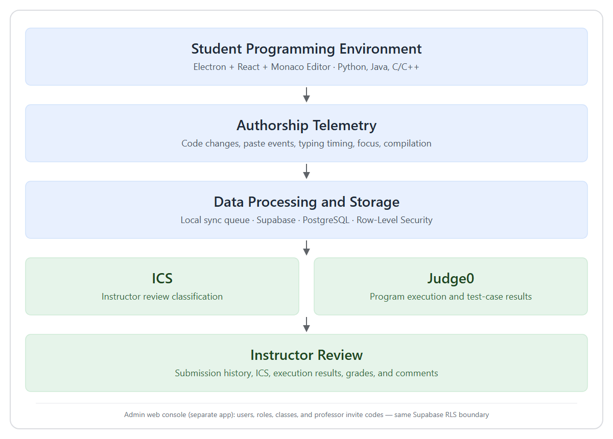
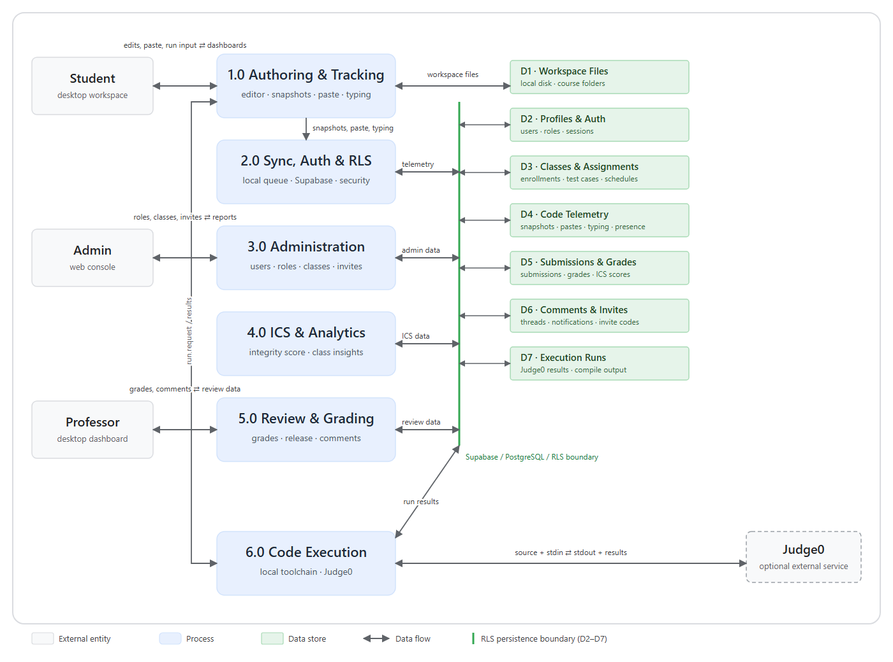

# Unicode Lab Documentation

This folder contains the paper-ready and QA-facing documentation for the current
Unicode Lab build.

| Document                                                                               | Purpose                                                                                                                  |
| -------------------------------------------------------------------------------------- | ------------------------------------------------------------------------------------------------------------------------ |
| [system-flow.svg](system-flow.svg) · [PNG](system-flow.png)                            | One-page system flow graphic: student environment → telemetry → storage → ICS/Judge0 → instructor review                 |
| [data-flow.svg](data-flow.svg) · [PNG](data-flow.png)                                  | Level 1 data flow diagram: external entities, processes, data stores, and the RLS persistence boundary                   |
| [ics-formula.svg](ics-formula.svg) · [PNG](ics-formula.png)                            | Current ICS formula diagram: paste, cadence, focus, compilation, rounding, and review bands                              |
| [ics-equation.png](ics-equation.png) · [full](ics-equation-full.png)                   | LaTeX-typeset ICS equation (main equation and full term definitions)                                                     |
| [survey-item-means.svg](survey-item-means.svg) · [PNG](survey-item-means.png)          | Preliminary survey item means grouped into current workflow and integrated-workspace preference                          |
| [survey-group-summary.svg](survey-group-summary.svg) · [PNG](survey-group-summary.png) | Group means and response distributions for the preliminary survey                                                        |
| [00_PLAIN_LANGUAGE_OVERVIEW.md](00_PLAIN_LANGUAGE_OVERVIEW.md)                         | Non-technical guide for advisers, panelists, and general readers                                                         |
| [01_FEATURE_MASTER_LIST.md](01_FEATURE_MASTER_LIST.md)                                 | Every implemented feature, grouped by category, with stable IDs and status                                               |
| [02_TECHNICAL_OVERVIEW.md](02_TECHNICAL_OVERVIEW.md)                                   | Architecture, data model, subsystems, data flows, security, and build/release details                                    |
| [03_QA_CHECKLIST.md](03_QA_CHECKLIST.md)                                               | Full manual and automated test checklist for demo/release readiness                                                      |
| [04_SYSTEM_REQUIREMENTS.md](04_SYSTEM_REQUIREMENTS.md)                                 | Filled Table 1 (software/platform requirements) with explanatory narrative                                               |
| [05_DEVELOPMENT_STATUS.md](05_DEVELOPMENT_STATUS.md)                                   | Filled Table 2 (development status) with current verification evidence                                                   |
| [06_PAPER_SECTION_4_3.md](06_PAPER_SECTION_4_3.md)                                     | Revised paper section 4.3 with implemented features, telemetry limits, storage/RLS, professor dashboard, and cross-links |
| [07_PRELIMINARY_SURVEY_RESULTS.md](07_PRELIMINARY_SURVEY_RESULTS.md)                   | Updated preliminary survey means, grouped results, distributions, and chart links                                        |
| [changelog/](changelog/README.md)                                                      | Dated change log entries; each begins with an overall summary of the batch                                               |

## System flow

The student workspace captures code, paste, typing, focus, and compilation
signals; a local queue persists them to Supabase/PostgreSQL under Row-Level
Security. ICS and optional Judge0 results then feed the instructor review
surface. The separate admin console writes users, roles, classes, and professor
invites through the same RLS boundary.

### Data flow (Level 1)

The diagram separates external entities, numbered processes, and data stores.
D1 is the local workspace on disk; D2–D7 are read and written through the
Supabase/PostgreSQL row-level-security boundary. Judge0 is optional and
external, so execution can also use the locally installed toolchain.

## Reading order for the paper

1. Start with **00_PLAIN_LANGUAGE_OVERVIEW.md** for a quick, non-technical
   explanation of the problem, users, workflow, and limits.
2. Use **01_FEATURE_MASTER_LIST.md** for the scope, feature inventory, and
   implemented-versus-not-implemented discussion.
3. Use **02_TECHNICAL_OVERVIEW.md** for methodology, system design, schema,
   security model, and implementation details.
4. Use **03_QA_CHECKLIST.md** for validation evidence and the demo runbook.
5. Use **04_SYSTEM_REQUIREMENTS.md** for the filled requirements table and the
   justification of the chosen platform and stack.
6. Use **05_DEVELOPMENT_STATUS.md** for the current development status table and
   the evidence behind each status claim.
7. Use **06_PAPER_SECTION_4_3.md** for the revised implementation narrative and
   its links to figures, tables, and subsystem documentation.

## Current snapshot

- Desktop app: Electron 44 + React 19 + TypeScript + Monaco, with bundled
  Pyright language intelligence for Python.
- Backend: Supabase Postgres, Auth, Realtime, Row-Level Security.
- Admin console: separate Vite/React web app in `admin-web/`.
- Local execution: PowerShell terminal and local toolchain runner.
- Timed assessments: server-authoritative take-home timers and live seatwork
  windows with drafts, resume, auto-submit, and a professor session monitor
  (Phase 1).
- Remote execution: Judge0 integration exists; a live endpoint is an external
  dependency and is not guaranteed in the demo environment.
- Automated checks: 74 Vitest tests and 41 live RLS regression checks.
- Windows installer: `dist/unicode-desktop-1.0.0-setup.exe` (126.16 MB).
- Installer SHA-256:
  `3106491895F542977C47A87D0876BE1E47775468DB24506247D0AA64FA905A81`.

## Documentation status

These files describe the code in this repository as of 2026-11-21. Update the
version, installer hash, test counts, and known-limitations sections whenever the
build changes.
